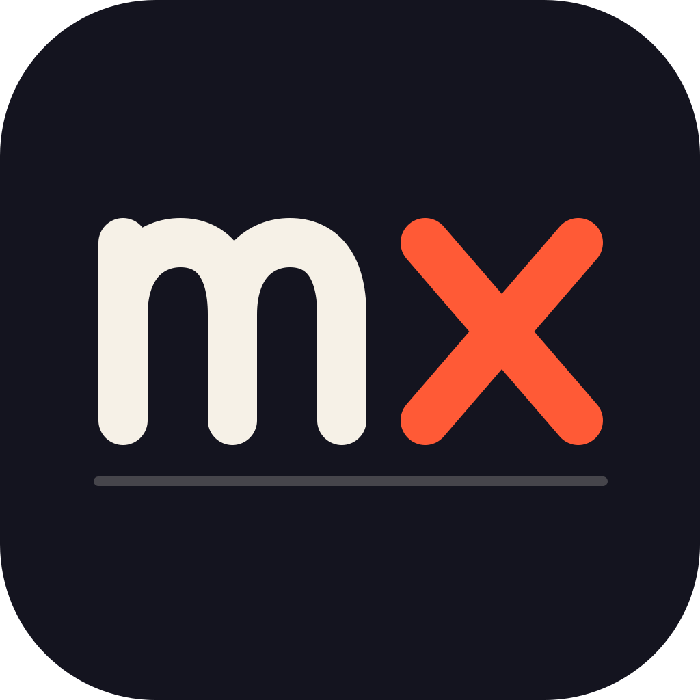

<p align="center"></p>

<h1 align="center">markDX</h1>

<p align="center"><strong>Write once. Present it. Run it. Cite it.</strong></p>

<p align="center">
  One Markdown app that works as a document, a slide deck and a runnable notebook,
  with citations built in. Local-first, MIT licensed, no accounts.
</p>

> **Status: in development.** There is no release yet. To try markDX, build it
> from source (below). Progress and open decisions are tracked in
> [`docs/markdx/PROGRESS.md`](docs/markdx/PROGRESS.md).

## What it does

**Today**

- A realtime-preview (WYSIWYG) Markdown editor: CommonMark, GitHub Flavored
  Markdown, math (KaTeX), Mermaid, Vega and PlantUML diagrams, front matter,
  footnotes, emoji.
- Source code, typewriter and focus modes; light and dark themes.
- Export to HTML and PDF, with a print preview.
- A `Doc | Deck | Notebook` switch in the title bar and command palette. Each is a
  view of the same file and never changes its text. A file with `marp: true` in its
  front matter opens as a deck; a `.ipynb` file, or `markdx: notebook`, as a
  notebook.

**Being built**

- **Decks** with [Marp](https://marp.app): slide preview, themes, presenter view,
  and export to HTML, PDF, PNG and PPTX.
- **Notebooks**: run fenced code cells in Python (Pyodide) or JavaScript, or
  against a local Jupyter kernel. Outputs are kept beside the file, so the
  Markdown stays clean, and nothing runs until you trust the document.
- **Citations** from Zotero, a `.bib` file or CSL-JSON, in Pandoc's `[@key]`
  syntax, formatted with CSL styles.

## Build from source

Requires Node.js 20.19 or later and pnpm 10.

```bash
pnpm install
pnpm run dev          # run in development mode
pnpm run build:mac    # or build:win, build:linux
```

Installers are written to `dist/`. More detail is in [`CLAUDE.md`](CLAUDE.md) and
the developer docs under `packages/website/content/docs/dev/`.

## Credits

<!-- keep-upstream-name -->markDX is a fork of [MarkText](https://github.com/marktext/marktext), and keeps its editor engine, Muya, and most of its desktop app. Thanks to everyone who built MarkText.

## License

[MIT](LICENSE). The upstream copyright notices are kept in `LICENSE`.
